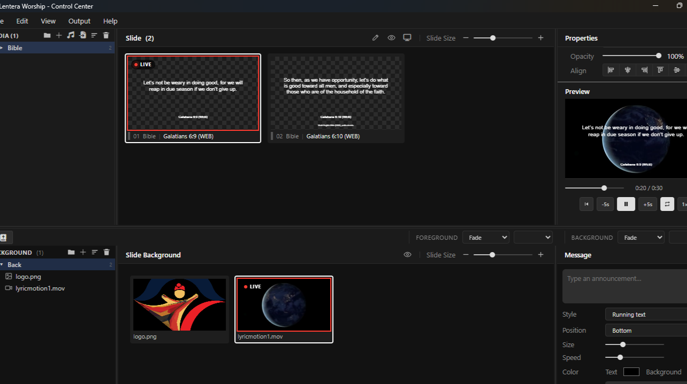

<p align="center">
  
</p>

<h1 align="center">Lentera Worship</h1>

<p align="center">
  <a href="README.md">🇬🇧 English</a> | 🇮🇩 Bahasa Indonesia
</p>

<p align="center">
  Aplikasi presentasi untuk lirik lagu, ayat Alkitab, dan slide ibadah.<br>
  Gratis dan open source.
</p>



## Fitur
- 🎵 **Lirik lagu**: tampilkan lirik slide demi slide
- 📖 **Ayat Alkitab**: tampilkan firman Tuhan saat ibadah
- 🖥️ **Tampilan proyektor**: layar keluaran bersih untuk proyektor
- 📡 **Keluaran NDI®**: kirim tampilan lewat jaringan ke perangkat lunak yang kompatibel dengan NDI ([ndi.video](https://ndi.video))

## Unduh (Windows)
Ambil installer terbaru di [halaman Releases](https://github.com/Kornelius1/lentera-worship/releases/latest).
Kami menyarankan file `-setup.exe` untuk kebanyakan pengguna. File `.msi` untuk instalasi terkelola.

> **Tentang peringatan Windows:** kamu mungkin melihat "Windows protected your PC".
> Klik **More info**, lalu **Run anyway**. Peringatan ini muncul karena aplikasi
> belum ditandatangani secara digital (belum memakai sertifikat berbayar), bukan
> karena ada virus.

### Verifikasi unduhan
Setiap halaman rilis mencantumkan checksum SHA256. Untuk memeriksa file kamu di PowerShell:

```powershell
Get-FileHash .\<nama-file> -Algorithm SHA256
```

Bandingkan hasilnya dengan checksum di halaman rilis.

## Konten dan hak cipta
Lisensi di bawah hanya mencakup kode aplikasi. Lirik lagu dan terjemahan
Alkitab mungkin dilindungi hak cipta. Pastikan kamu berhak memakai konten yang
kamu tambahkan.

## Terjemahan Alkitab
Aplikasi mengunduh terjemahan Alkitab dari [eBible.org](https://ebible.org). Masing-masing punya lisensi sendiri:

| Terjemahan | Lisensi |
|---|---|
| TSI (Terjemahan Sederhana Indonesia) | CC BY-SA 4.0 |
| BFA (Alkitab Gratis untuk Semua) | CC BY-SA 4.0 |
| BSB (Berean Standard Bible) | Domain publik |
| WEB (World English Bible) | Domain publik |

Aplikasi memakai internet untuk mengunduh terjemahan ini. Lisensi mereka terpisah
dari lisensi MIT OR Apache-2.0 proyek ini.

## NDI
Keluaran NDI bersifat opsional saat build dari source (`--features ndi`).
Installer rilis sudah menyertakannya, beserta runtime NDI
(`Processing.NDI.Lib.x64.dll`) dari NDI SDK milik Vizrt NDI AB. Library itu
dilisensikan di bawah
[NDI SDK License Agreement](http://ndi.link/ndisdk_license)
dan **tidak** tercakup lisensi MIT OR Apache-2.0 proyek ini.

NDI® is a registered trademark of Vizrt NDI AB. [ndi.video](https://ndi.video)
Lentera Worship tidak berafiliasi dengan atau didukung oleh Vizrt NDI AB.

**Build dari source dengan NDI:** pasang NDI SDK, salin `Bin\x64\Processing.NDI.Lib.x64.dll`
dari SDK ke `src-tauri/libs/`, lalu jalankan (dari folder `lentera-worship`):

```bash
cargo tauri build --features ndi --config src-tauri/tauri.ndi.conf.json
```

## Build dari source
Kebutuhan: [Rust](https://rustup.rs) 1.90 atau lebih baru, [Node.js](https://nodejs.org),
dan Tauri CLI.

```bash
cargo install tauri-cli --version "^2" --locked
cd lentera-worship
npm install
cargo tauri dev          # jalankan untuk pengembangan
cargo tauri build        # buat installer
```

## Kontribusi
Issue dan pull request sangat diterima.

## Lisensi
Dilisensikan di bawah salah satu dari

- [Apache License, Version 2.0](LICENSE-APACHE)
- [Lisensi MIT](LICENSE-MIT)

sesuai pilihan kamu.

### Kontribusi (ketentuan lisensi)
Kecuali dinyatakan lain secara eksplisit, setiap kontribusi yang sengaja
diajukan untuk dimasukkan ke proyek ini, sebagaimana didefinisikan dalam
lisensi Apache-2.0, akan dilisensikan ganda seperti di atas, tanpa syarat
atau ketentuan tambahan.

## Pihak ketiga
- [Font Awesome Free](https://fontawesome.com/license/free): ikon CC BY 4.0, font SIL OFL 1.1, kode MIT.
- Runtime NDI: lihat bagian NDI di atas.