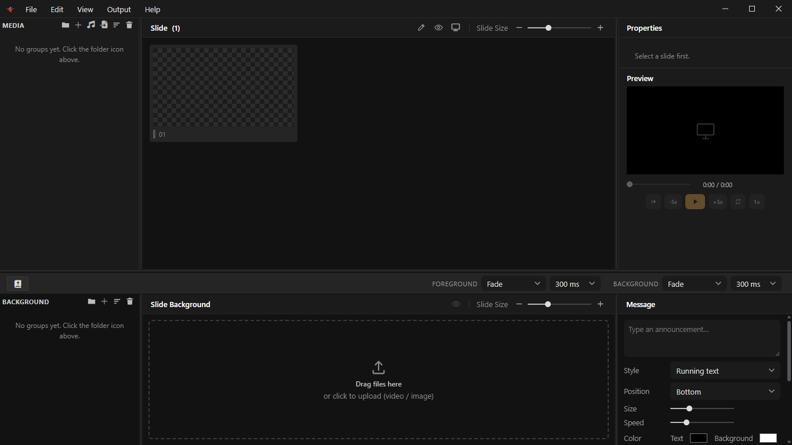

<p align="center">
  
</p>

<h1 align="center">Lentera Worship</h1>

<p align="center">
  🇬🇧 English | <a href="README.id.md">🇮🇩 Bahasa Indonesia</a>
</p>

<p align="center">
  Presentation software for song lyrics, Bible verses, and worship slides.<br>
  Free and open source.
</p>

<p align="center">
  <a href="https://github.com/Kornelius1/lentera-worship/releases/latest">
    
  </a>
</p>
<p align="center">
  
  
  
</p>



## Features
- 🎵 **Song lyrics**: display lyrics slide by slide
- 📖 **Bible verses**: show scripture during the service
- 🖥️ **Projector view**: a clean output screen for the projector
- 📡 **NDI® output**: send the output over the network to NDI-compatible software ([ndi.video](https://ndi.video))

## Download (Windows)
Get the latest installer from the [Releases page](https://github.com/Kornelius1/lentera-worship/releases/latest).
We recommend the `-setup.exe` file for most users. The `.msi` is for managed deployment.

> **About the Windows warning:** you may see "Windows protected your PC".
> Click **More info**, then **Run anyway**. The warning appears because the app
> is not yet digitally signed (no paid certificate), not because it contains a virus.

### Verify your download
Each release page lists SHA256 checksums. To check your file in PowerShell:

```powershell
Get-FileHash .\<file-name> -Algorithm SHA256
```

Compare the result with the checksum on the release page.

## Content and copyright
The license below covers the application code only. Song lyrics and Bible
translations may be protected by copyright. Make sure you have the right to use
any content you add.

## Bible translations
The app downloads Bible translations from [eBible.org](https://ebible.org). Each keeps its own license:

| Translation | License |
|---|---|
| TSI (Terjemahan Sederhana Indonesia) | CC BY-SA 4.0 |
| BFA (Alkitab Gratis untuk Semua) | CC BY-SA 4.0 |
| BSB (Berean Standard Bible) | Public domain |
| WEB (World English Bible) | Public domain |

The app uses the internet to download these translations. Their licenses are
separate from this project's MIT OR Apache-2.0 license.

## NDI
NDI output is optional when building from source (`--features ndi`). Release
installers include it and bundle the NDI runtime (`Processing.NDI.Lib.x64.dll`)
from the NDI SDK by Vizrt NDI AB. That library is licensed under the
[NDI SDK License Agreement](http://ndi.link/ndisdk_license)
and is **not** covered by this project's MIT OR Apache-2.0 license.

NDI® is a registered trademark of Vizrt NDI AB. [ndi.video](https://ndi.video)
Lentera Worship is not affiliated with or endorsed by Vizrt NDI AB.

**Build from source with NDI:** install the NDI SDK, copy `Bin\x64\Processing.NDI.Lib.x64.dll`
from the SDK to `src-tauri/libs/`, then run (from the `lentera-worship` folder):

```bash
cargo tauri build --features ndi --config src-tauri/tauri.ndi.conf.json
```

## Build from source
Requirements: [Rust](https://rustup.rs) 1.90 or newer, [Node.js](https://nodejs.org),
and the Tauri CLI.

```bash
cargo install tauri-cli --version "^2" --locked
cd lentera-worship
npm install
cargo tauri dev          # run in development
cargo tauri build        # build the installer
```

## Contributing
Issues and pull requests are welcome.

## License
Licensed under either of

- [Apache License, Version 2.0](LICENSE-APACHE)
- [MIT license](LICENSE-MIT)

at your option.

### Contribution
Unless you explicitly state otherwise, any contribution intentionally submitted
for inclusion in this project, as defined in the Apache-2.0 license, shall be
dual licensed as above, without any additional terms or conditions.

## Third-party
- [Font Awesome Free](https://fontawesome.com/license/free): icons CC BY 4.0, fonts SIL OFL 1.1, code MIT.
- NDI runtime: see the NDI section above.